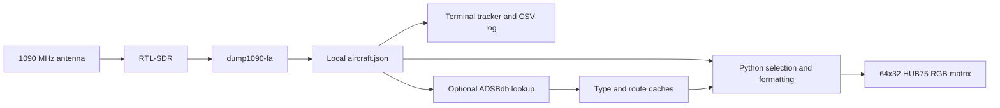

# Raspberry Pi ADS-B Aircraft Tracker

**1090 MHz aircraft reception, Python telemetry processing, and a 64 × 32 RGB LED matrix.**

I built an ADS-B aircraft tracker using a Raspberry Pi, RTL-SDR receiver, and a HUB75 RGB LED matrix. The project reads aircraft messages decoded by **dump1090-fa**, selects a recently observed aircraft, and displays its callsign, type, barometric altitude, groundspeed, and track on a compact physical display. I also developed a rolling terminal tracker and an optional metadata cache to display aircraft types and flight routes when available.

The project brings together **RF/SDR, Linux, Python, GPIO-driven display hardware, and real-time data processing**.

## Engineering highlights

- **Live receiver pipeline:** Uses locally decoded aircraft telemetry from `/run/dump1090-fa/aircraft.json`, updated by the separate dump1090-fa decoder.
- **Aircraft selection:** Filters out aircraft last observed 90 or more seconds ago, then prioritizes entries with usable type, route, flight identifier, altitude, speed, and message count.
- **64 × 32 display:** Renders identification, aircraft type, altitude, groundspeed, and track through Pillow and the `rgbmatrix` Python binding. It alternates to a route screen when route metadata is available.
- **Automatic night mode:** Uses the Pi's local time to adjust hardware brightness between 20:00 and 07:00, with additional nighttime pixel dimming.
- **Rolling aircraft monitor:** Tracks observed aircraft, displays recent reception information in a terminal, and appends first sightings during each program run to a local CSV log.
- **Optional metadata enrichment:** Queries ADSBdb for ICAO aircraft-type and callsign-route details and saves them in local JSON caches.

**Data provenance:** The SDR/dump1090 decoder supplies live broadcast-derived position/altitude/speed-related fields when available. Aircraft-type details and routes are additional **third-party lookups**, not data broadcast as a full flight itinerary by the aircraft.

## Architecture



`adsb_matrix.py` refreshes the display once per second. `adsb_roll.py` provides a two-second rolling console update. `adsb_lookup_cache.py` handles optional external lookups separately, allowing basic ADS-B reception and display without a network metadata service.

## Hardware and dependencies

| Part | Role |
| --- | --- |
| Raspberry Pi | Linux processing and GPIO output |
| RTL-SDR and 1090 MHz antenna | Mode S / ADS-B RF reception |
| 64 × 32 HUB75 RGB matrix | Physical live aircraft display |
| dump1090-fa | Decoding and `/run/dump1090-fa/aircraft.json` output |
| `rpi-rgb-led-matrix` | Raspberry Pi panel driver and Python bindings |
| Pillow | Image/text rendering |
| ADSBdb (optional) | Aircraft/route lookup enrichment |

The current matrix configuration is **64 columns × 32 rows, one chain, one parallel channel, and `adafruit-hat` mapping**. These settings must match the actual adapter/panel wiring. See [setup and wiring](docs/SETUP.md).

## Project structure

```text
adsb_matrix.py          Live LED matrix application
adsb_roll.py            Rolling terminal view and local CSV capture
adsb_lookup_cache.py    External aircraft and route metadata updater
examples/               Synthetic aircraft JSON and metadata examples
tests/                  Offline Python unit tests
docs/                   Setup, architecture, validation and attribution
requirements.txt        Pillow dependency; matrix bindings are hardware-specific
```

The repository **does not bundle** FlightAware dump1090-fa, the RGB LED matrix driver, compiled binaries, or nested Git history. These are external dependencies with their own licenses.

## Running on a Raspberry Pi

1. Configure **dump1090-fa** for an RTL-SDR receiver and verify the local JSON feed at `/run/dump1090-fa/aircraft.json`.
2. Install Pillow and the `rpi-rgb-led-matrix` Python bindings for your Pi OS/Python environment (see [setup](docs/SETUP.md)).
3. Clone this repository onto the Pi and run:

   ```bash
   python3 adsb_matrix.py
   ```

4. In another terminal, the optional console tracker can run with:

   ```bash
   python3 adsb_roll.py
   ```

5. To update aircraft and flight-route caches on demand:

   ```bash
   python3 adsb_lookup_cache.py
   ```

The display process requires access to Raspberry Pi matrix hardware; installation and permissions depend on the driver and operating system.

### Portable paths

| Environment variable | Default | Purpose |
| --- | --- | --- |
| `ADSB_AIRCRAFT_JSON` | `/run/dump1090-fa/aircraft.json` | Decoder output location |
| `ADSB_DATA_DIR` | Directory containing each script | Local type/route caches and capture log |

I changed only the original scripts' **machine-specific file paths** to these portable settings; the aircraft selection, display, rolling capture, and lookup logic remain otherwise unchanged.

Local `aircraft_types.json`, `routes.json`, and `captured_aircraft_log.csv` are excluded from Git. The files in `examples/` are **synthetic**, not actual received flights.

## Testing and development status

The application code has been checked for Python syntax. Offline unit tests cover metadata extraction, cache persistence, and example file formats. Run them from the repository root:

```bash
python3 -m unittest discover -s tests -v
```

A reproducible hardware setup, complete decoder-to-matrix demonstration, RF reception measurements, and display reliability benchmarks have not yet been added to this repository. See the [verification plan](docs/VALIDATION.md).

### Planned improvements

- Add photos/video of the actual receiver, antenna and LED matrix showing decoded live traffic.
- Record Raspberry Pi, RTL-SDR, adapter, Python and library versions.
- Measure receiver message throughput, matrix loop timing and 24-hour stability.
- Extract aircraft selection/rendering into pure functions for comprehensive unit tests.
- Add resilient caching, controlled lookup frequency and service-startup configuration.

## Credits and scope

My contribution is the Python aircraft presentation, rolling-monitor and lookup-cache application. **dump1090-fa** and **rpi-rgb-led-matrix** are independently maintained open-source projects; see [dependency attribution](docs/THIRD_PARTY.md). I haven't selected a blanket license for the custom source yet.

This is an experimental educational project, **not a certified aircraft surveillance system** or a substitute for operational traffic information.
